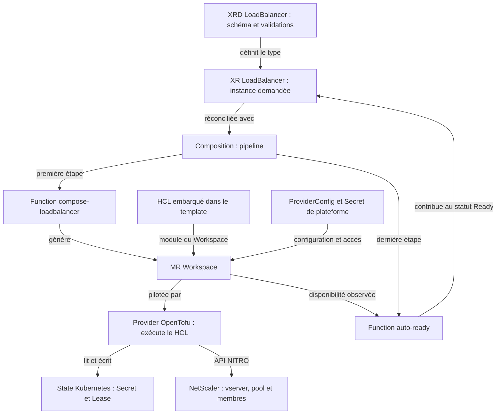

# NS-012 — Produit LoadBalancer par XRD et Composition

Date de préparation : 9 octobre 2026.

**Statut : EN COURS — rendu local, configuration NS012, build et publication OCI validés. Vérification de la XRD et déploiement du produit dans le cluster à confirmer.**

Destination dans le dépôt : `00-docs/spikes/NS-012.md`.

## Objectif

Permettre au consommateur de déclarer un LB par une ressource produit, sans écrire ni modifier le HCL du Workspace. Vérifier la chaîne **XR LoadBalancer → Composition → MR Workspace → OpenTofu → NetScaler → backends**.

Le spike est avancé dans l’ordre d’exécution après NS004. Il qualifie l’API produit et sa composition ; il ne remplace pas les autres spikes de robustesse, sécurité, concurrence et limites du provider.

## Références

- [NS004 — intégration par MR Workspace](NS-004.md).
- [NS002 — module HCL et limites](NS-002.md).
- [NS003 — identité du state](NS-003.md).
- [README du lab](../../01-lab/README.md).
- [Protocole global](../poc_netscaler_crossplane_spikes.md).

## État de départ

Crossplane 2.4.0, provider OpenTofu v1.1.8 avec moteur 1.10.0, provider CitrixADC 2.3.0, CPX et deux backends disponibles. À la fin de NS004, le MR et les objets ADC ont été supprimés ; le provider, le ProviderConfig et le Secret NITRO restent présents. Le namespace netscaler-state est conservé.

Le script `01-lab/crossplane/ns004/refresh-ips.py` actualise le manifeste autonome NS004. Il ne configure pas automatiquement les futurs XR NS012. Les IP courantes devront être fournies explicitement au scénario NS012 ; leur découverte dans une plateforme cible n’est pas qualifiée ici.

## Périmètre initial proposé

- XRD namespaced et XR produit LoadBalancer, groupe `networking.archerry.fr`, version `v1alpha1`.
- Paramètres initiaux : VIP, port d’écoute, méthode et membres backend identifiés par une clé stable.
- Identifiant du produit utilisé pour dériver des noms ADC et une identité de state propres à NS012.
- Composition réutilisant le HCL validé ; Workspace généré et piloté par la Composition.
- Credentials transmis par référence au Secret du lab ; aucun mot de passe dans le XR ou les manifests Git.
- Configuration d’accès et backend traités comme paramètres de plateforme, pas comme champs secrets à renseigner par le consommateur.
- Status produit : informations utiles du LB et disponibilité issue des ressources composées, complétée par un test HTTP explicite.

L’isolation de noms et de state est nécessaire même si le lab n’héberge initialement qu’un seul produit. La gestion d’objets partagés n’est pas démontrée par cette première Composition.

## Étapes et preuves attendues

| Étape | Travail | Preuve attendue |
|---|---|---|
| Inventaire | Lire crossplane-project.yaml, arborescence apis et Functions installées | Choix cohérent avec le projet ; versions relevées |
| API produit | Définir XRD, schéma et XR d’exemple | API établie, exemple accepté, paramètres utiles et contrôlés |
| Composition | Générer le Workspace et sélectionner sa configuration | MR namespaced composé avec références et identité propres |
| Création | Appliquer le XR | Réconciliation XR/MR, LB UP, deux membres actifs |
| Trafic et status | Lire outputs/status puis envoyer vingt requêtes | Informations produit disponibles et réponses A/B |
| Modification | Retirer puis rétablir un membre dans le XR seulement | Composition et Workspace convergent ; trafic conforme |
| Suppression | Supprimer le XR | Nettoyage du MR et des objets ADC ; backends préservés |
| Rejeu | Reprendre depuis les fichiers versionnés | Procédure documentée, sans state local ni HCL à modifier par le consommateur |

## Premier inventaire à exécuter

Depuis la racine du dépôt :

```bash
cat crossplane-project.yaml
find apis -maxdepth 3 -type f
kubectl --context kind-netscaler-provider get functions.pkg.crossplane.io
kubectl --context kind-netscaler-provider get providers.pkg.crossplane.io
```

Résultats relevés : CLI Crossplane 2.5.0, serveur 2.4.0, provider OpenTofu installé et sain. Le dossier `apis` ne contenait initialement que `.gitkeep`. La commande d’inventaire des Functions a renvoyé `No resources found` : aucune Function n’est installée, ce qui ne constitue pas une erreur.

Le projet utilise désormais le dépôt OCI `registry.netscaler-provider.local:5000/netscaler-provider`. L’accès HTTPS au registry depuis la WSL a été validé avec le certificat du bootstrap :

```bash
curl -fsS --connect-timeout 5 --max-time 10 \
  --cacert /home/flore/.local/state/platform-bootstrap/netscaler-provider/registry/certs/domain.crt \
  https://registry.netscaler-provider.local:5000/v2/
```

Résultat observé : `{}`. Le certificat reste géré par le bootstrap ; aucune copie propre à NS012 n’est nécessaire. La publication du package reste à tester.

## Préparer l’API produit

### 1. Écrire l’exemple de consommation

Créer `examples/loadbalancers/ns012-http.yaml` avec le type `LoadBalancer`, le nom `ns012-http` et le namespace `netscaler-ns012`. L’exemple décrit la VIP, le port d’écoute, la méthode de répartition et les deux backends identifiés par les clés stables `a` et `b`.

Les IP utilisées dans l’exemple doivent correspondre aux adresses Docker courantes. Les credentials NITRO, l’accès à l’ADC et la configuration du state relèvent de la plateforme et ne sont pas demandés au consommateur dans cette XR.

### 2. Générer la XRD initiale avec la CLI

Depuis la racine du dépôt :

```bash
crossplane xrd generate examples/loadbalancers/ns012-http.yaml \
  --plural loadbalancers \
  --path loadbalancers/definition.yaml

cat apis/loadbalancers/definition.yaml
```

Résultat observé : la CLI a généré `apis/loadbalancers/definition.yaml`, avec le scope `Namespaced`, le groupe `networking.archerry.fr`, le type `LoadBalancer` et la version `v1alpha1`. Cette génération prépare un fichier local ; elle n’installe pas l’API dans le cluster.

### 3. Compléter les validations du schéma

La CLI déduit les types depuis l’exemple. Le schéma initial a ainsi figé les membres `a` et `b` et n’imposait pas encore les règles du produit. La définition finale proposée complète ce squelette avec :

- VIP et adresses des backends au format IPv4 valide.
- Ports compris entre 1 et 65535.
- Méthodes autorisées : `ROUNDROBIN` et `LEASTCONNECTION`, avec `ROUNDROBIN` par défaut.
- VIP, port d’écoute et pool de backends obligatoires.
- Pool à clés libres, avec au moins un membre ; chaque membre exige une IP et un port.

Les clés restent des identifiants stables : elles ne sont plus limitées à `a` et `b`. Le HCL et les détails d’exécution restent derrière la Composition.

Le schéma complet est versionné dans `apis/loadbalancers/definition.yaml` ; ce compte rendu présente les règles sans dupliquer sa définition technique.

### 4. Vérifier la définition sur le cluster sans l’installer

```bash
kubectl --context kind-netscaler-provider apply \
  --dry-run=server \
  -f apis/loadbalancers/definition.yaml
```

Attendu : la définition est acceptée en dry-run, sans création de la XRD. **Résultat réel : à confirmer.**

Ce contrôle vérifie l’acceptation du manifeste de XRD par le serveur. Il ne démontre pas encore que l’API produit est établie ni que toutes ses validations rejettent les XR invalides. Ces tests seront réalisés après installation de la XRD.

Ne pas appliquer l’exemple de XR tant que son API et la Composition ne sont pas préparées. Les fichiers à versionner pour cette étape sont l’exemple de consommation et la définition de XRD.

## Architecture du produit



La XRD définit l’API du produit ; elle ne contient pas le HCL. La Composition sélectionne la chaîne de Functions. La Function de composition traduit les paramètres du XR en manifeste Workspace, avec le HCL embarqué. Le provider OpenTofu exécute ce module et gère son state ; le provider CitrixADC utilisé dans le module dialogue avec NetScaler.

L’évaluation Ready ne remplace pas les tests HTTP et les vérifications de convergence : ces preuves restent nécessaires dans le spike.

### Produit et instance de produit

Le produit est le type d’API `LoadBalancer`. Chaque XR est une instance de ce produit. Les noms ADC sont propres à **chaque instance**, et non simplement au type LoadBalancer.

Le template dérive une identité stable du couple `metadata.namespace` / `metadata.name`, sous la forme `ns012-<empreinte>`. Cette identité sert au nom du Workspace, à son external-name et aux noms du vserver et du pool. Deux XR de noms différents, ou placées dans des namespaces différents, obtiennent des identités distinctes en pratique ; l’empreinte est tronquée à 16 caractères et ne constitue pas une garantie absolue d’absence de collision.

Modifier la VIP, le port, la méthode ou les backends ne change pas cette identité. Supprimer puis recréer une XR avec le même namespace et le même nom réutilise les mêmes noms calculés. La stratégie actuelle ne dépend pas de l’UID Kubernetes et ne démontre pas une isolation entre générations successives d’une même XR.

Des identités distinctes ne rendent pas disponibles deux listeners sur le même couple VIP/port : le lab doit attribuer un port ou une VIP distincte aux instances simultanées.

## Développer la Composition et la Function

Toutes les commandes suivantes s’exécutent depuis la racine du dépôt. Les générations CLI produisent des fichiers locaux ; elles n’installent pas les ressources dans le cluster.

### 1. Générer le squelette de Composition

```bash
crossplane composition generate \
  apis/loadbalancers/definition.yaml

cat apis/loadbalancers/composition.yaml
cat crossplane-project.yaml
```

Résultat observé : `apis/loadbalancers/composition.yaml` référence le type `networking.archerry.fr/v1alpha1`, kind `LoadBalancer`, en mode Pipeline. La pipeline initiale contient uniquement `crossplane-contrib-function-auto-ready`.

La CLI ajoute la dépendance `xpkg.crossplane.io/crossplane-contrib/function-auto-ready` au projet, avec la contrainte initiale `>=v0.0.0`. Cette déclaration ne signifie pas que la Function est installée. La version résolue, v0.7.0, a ensuite été figée dans le projet avant la publication.

### 2. Générer la Function embarquée en Go templating

```bash
crossplane function generate compose-loadbalancer \
  apis/loadbalancers/composition.yaml \
  --language go-templating

find functions/compose-loadbalancer -maxdepth 2 -type f
cat apis/loadbalancers/composition.yaml
cat crossplane-project.yaml
cat functions/compose-loadbalancer/00-prelude.yaml.gotmpl
```

Résultats observés :

- `00-prelude.yaml.gotmpl` récupère le XR observé dans la variable `$xr`.
- `01-compose.yaml.gotmpl` fournit un squelette pour les ressources composées.
- La pipeline appelle d’abord `compose-loadbalancer`, via la référence générée `netscaler-providercompose-loadbalancer`, puis `crossplane-contrib-function-auto-ready`.

Conserver la référence générée par la CLI : elle identifie la Function embarquée que le projet construira et déploiera.

### 3. Écrire le template Workspace

Remplacer le contenu de `functions/compose-loadbalancer/01-compose.yaml.gotmpl` par le template Workspace fourni pour NS012. Conserver le prelude.

Le template reprend le HCL validé dans NS004, avec les adaptations suivantes :

- VIP, port d’écoute, méthode et backends proviennent du XR.
- Les noms du vserver et du pool deviennent des variables du module, alimentées par l’identité de l’instance.
- Le Workspace est créé dans le même namespace que le XR et référence le ProviderConfig `ns012`.
- URL NITRO, login et mot de passe sont lus via des références au Secret `ns012-nitro` du même namespace. Le Secret contient les clés `NS_URL`, `NS_LOGIN` et `NS_PASSWORD` ; aucun mot de passe n’est versionné.
- Le module conserve les cinq ressources du scénario à deux backends, la gestion des membres par clés stables et la règle de remplacement du binding lors d’un changement de port.
- Le module expose les outputs `lb_name` et `lb_port`. Leur projection dans le status du produit reste à ajouter et à valider.

La VIP du LB et l’adresse de management NITRO sont deux paramètres distincts, même si le lab CPX utilise actuellement la même IP pour les deux.

Le HCL appartient au code de la Function et devient le module du Workspace généré. Le consommateur décrit uniquement son instance dans le XR ; il ne modifie ni la MR composée ni son module.

### 4. Vérifier le rendu local

```bash
mkdir -p .local/ns012

crossplane composition render \
  examples/loadbalancers/ns012-http.yaml \
  apis/loadbalancers/composition.yaml \
  --crossplane-version=v2.4.0 \
  > .local/ns012/rendered.yaml

NS012_RENDER_EXIT=$?
printf 'Code du rendu : %s\n' "$NS012_RENDER_EXIT"

cat .local/ns012/rendered.yaml
```

Résultat observé : code `0`. Le Workspace généré est `ns012-c9526cf25a142b46`, dans `netscaler-ns012`, avec le ProviderConfig `ns012`, les trois références au Secret `ns012-nitro` et le module HCL attendu.

Paramètres relevés : VIP `172.18.0.6`, port `8080`, méthode `ROUNDROBIN`, backend A `172.18.0.7:8080` et backend B `172.18.0.8:8080`. Noms ADC calculés : `ns012-c9526cf25a142b46-http` et `ns012-c9526cf25a142b46-pool`.

Le rendu rapporte `Synced=True` et `Ready=False`, avec `Unready resources: workspace`. Ce sont des conditions simulées : le Workspace réel n’est pas encore créé. Aucun accès NITRO ni exécution OpenTofu n’a lieu dans ce rendu. Les dates et l’UID présents dans cette sortie ne sont pas des preuves du cluster réel.

### 5. Préparer la configuration de plateforme NS012

Créer `01-lab/crossplane/ns012/provider-config.yaml`. Il reprend les contraintes moteur OpenTofu `>= 1.10.0, < 1.11.0`, provider CitrixADC `2.3.0` et backend Kubernetes avec `in_cluster_config = true`, namespace de state `netscaler-state` et suffixe `ns012`.

Le ProviderConfig est nommé `ns012`, dans `netscaler-ns012`. Le suffixe distingue le scénario ; le workspace OpenTofu nommé d’après l’instance distingue ensuite les instances. Cette isolation du state reste à vérifier lors du premier déploiement réel.

```bash
mkdir -p 01-lab/crossplane/ns012

kubectl --context kind-netscaler-provider create namespace \
  netscaler-ns012 --dry-run=client -o yaml \
  | kubectl --context kind-netscaler-provider apply -f -

(
  set -euo pipefail

  cpx_ip="$(docker inspect poc-netscaler-cpx \
    --format '{{with index .NetworkSettings.Networks "kind"}}{{.IPAddress}}{{end}}')"

  cpx_password="$(docker exec poc-netscaler-cpx \
    cat /var/deviceinfo/random_id)"

  printf 'NS_URL=http://%s:9080\nNS_LOGIN=nsroot\nNS_PASSWORD=%s\n' \
    "$cpx_ip" "$cpx_password" \
    | kubectl --context kind-netscaler-provider create secret generic \
        ns012-nitro \
        -n netscaler-ns012 \
        --from-env-file=/dev/stdin \
        --dry-run=client -o yaml \
    | kubectl --context kind-netscaler-provider apply -f -
)

kubectl --context kind-netscaler-provider apply \
  -f 01-lab/crossplane/ns012/provider-config.yaml

kubectl --context kind-netscaler-provider get \
  providerconfigs.opentofu.m.upbound.io,secrets \
  -n netscaler-ns012
```

Résultat observé : ProviderConfig `ns012` présent et Secret `ns012-nitro` de type Opaque avec trois clés. Le fichier `random_id` fournit le mot de passe généré du lab ; si celui-ci a été changé manuellement, utiliser le credential courant. Le manifeste du Secret et son contenu ne sont pas enregistrés dans Git.

### 6. Figer les dépendances et construire le package

Le premier build a résolu `auto-ready` en v0.7.0. Le cache a relevé le digest `sha256:989e7bb4704859cbd6475cc61255b4b4ad53483ea43f3d2d1e4be5e3ff678869` pour cette dépendance. La section `dependencies` de `crossplane-project.yaml` a ensuite été fixée à :

```yaml
dependencies:
  - type: xpkg
    xpkg:
      apiVersion: pkg.crossplane.io/v1
      kind: Function
      package: xpkg.crossplane.io/crossplane-contrib/function-auto-ready
      version: v0.7.0
  - type: xpkg
    xpkg:
      apiVersion: pkg.crossplane.io/v1
      kind: Provider
      package: xpkg.upbound.io/upbound/provider-opentofu
      version: v1.1.8
```

```bash
crossplane dependency update-cache
```

Après succès de l’actualisation :

```bash
crossplane project build
NS012_BUILD_EXIT=$?
printf 'Code du build : %s\n' "$NS012_BUILD_EXIT"

find _output -maxdepth 2 -type f
```

Résultat observé : code du build `0`, package `_output/netscaler-provider.xpkg`. Le build prépare le package Configuration et la Function embarquée ; il ne les installe pas dans Crossplane. Les versions déclarées sont figées, sans revendiquer à ce stade une reconstruction bit pour bit identique.

Les artefacts générés restent locaux. Règles ajoutées au `.gitignore` :

```gitignore
# Schémas et bindings générés par la CLI Crossplane
/schemas/

# Packages construits par la CLI Crossplane
/_output/
```

Cela exclut également `schemas/.lock.json`. Les dépendances restent déclarées dans le projet ; leur cache est régénérable via la CLI. `.local/` est déjà ignoré.

### 7. Publier dans le registry du bootstrap

```bash
SSL_CERT_FILE="/home/flore/.local/state/platform-bootstrap/netscaler-provider/registry/certs/domain.crt" \
  crossplane project push --tag=v0.1.0-ns012.1

NS012_PUSH_EXIT=$?
printf 'Code du push : %s\n' "$NS012_PUSH_EXIT"
```

Résultat observé : code `0`, avec publication de :

- La Function embarquée dans le dépôt `registry.netscaler-provider.local:5000/netscaler-provider_compose-loadbalancer` ; son tag exact n’a pas été affiché dans la sortie partagée.
- La Configuration `registry.netscaler-provider.local:5000/netscaler-provider:v0.1.0-ns012.1`.

Le push publie les packages ; il ne les installe pas dans le cluster. La publication des dépendances externes n’est pas revendiquée : elles restent référencées par le package.

La variable `SSL_CERT_FILE` fournit, pour cette commande, la confiance envers le certificat autosigné du bootstrap. Le chemin déterministe permet de le retrouver, mais ne l’ajoute pas à la confiance du système. Le fichier projet ne propose pas de champ de certificat CA pour le push. Une amélioration du bootstrap peut installer le certificat dans la confiance WSL ou fournir un environnement de publication ; cette amélioration n’est pas réalisée par NS012.

### 8. Suite des vérifications

- Installer les packages publiés sur le cluster existant et vérifier leur santé ainsi que l’accès au registry depuis Crossplane.
- Vérifier l’établissement de l’API et le rejet des XR invalides.
- Appliquer la XR et contrôler la convergence, le state, les objets ADC et le trafic.
- Faire remonter les outputs utiles dans le status produit, puis qualifier modification et suppression depuis la XR.

### Fichiers de développement à versionner

| Fichier | Rôle |
|---|---|
| `examples/loadbalancers/ns012-http.yaml` | Exemple de demande produit |
| `apis/loadbalancers/definition.yaml` | Schéma et validations de l’API |
| `apis/loadbalancers/composition.yaml` | Pipeline de composition |
| `functions/compose-loadbalancer/00-prelude.yaml.gotmpl` | Accès au XR observé |
| `functions/compose-loadbalancer/01-compose.yaml.gotmpl` | Construction du Workspace et HCL embarqué |
| `crossplane-project.yaml` | Dépôt OCI et dépendances du projet |
| `01-lab/crossplane/ns012/provider-config.yaml` | Configuration OpenTofu et backend du scénario |
| `.gitignore` | Exclusion des fichiers locaux et générés |
| `00-docs/spikes/NS-012.md` | Mode opératoire et preuves du spike |

## Limites et critères de validation

Ne pas modifier directement le MR généré pour les tests produit : les changements doivent partir du XR. Une Composition peut rétablir la déclaration d’un MR modifié à la main.

Ready du produit et service HTTP sont deux preuves distinctes. Conserver les réserves NS004 : startup Round Robin possible, remplacement pouvant interrompre le trafic, state Kubernetes dépendant de la survie du cluster kind et IP du lab dynamiques.

Le succès NS012 ne constitue pas une qualification production. Les tests des autres spikes restent à exécuter et peuvent imposer une évolution de l’API ou de la Composition.

**Décision finale : À PRENDRE après création, modification et suppression par le XR avec preuves ADC et HTTP.**
